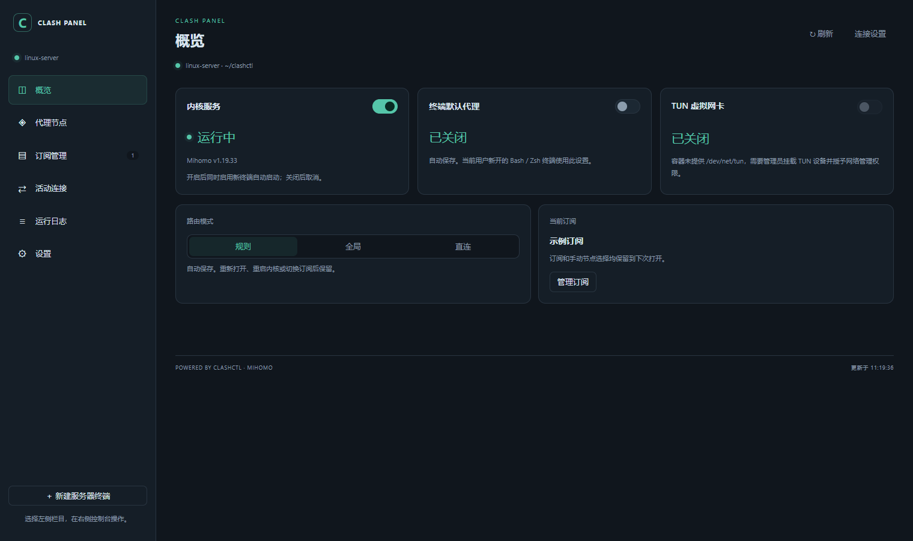

# Clash Panel

在 VS Code 中管理 Linux 上的 clashctl / Mihomo，支持 Remote SSH 和本机通过 SSH 管理服务器。

## 安装

**服务器尚未安装 clashctl**：按[安装教程](https://github.com/zkyqust/clash-for-linux-panel#安装方式)运行 `setup.sh`，安装 clashctl / Mihomo 和界面插件。

**服务器已有 clashctl**：从[下载页面](https://github.com/zkyqust/clash-for-linux-panel/releases/latest)下载 `.vsix`，直接安装插件即可。

手动安装插件：

1. 在 VS Code 的 Remote SSH 窗口，打开 **扩展 → … → 从 VSIX 安装**，选择安装包并安装到 **SSH 主机**。文件选择器只显示服务器文件时，先上传 VSIX。
2. 按 `Ctrl+Shift+P`，执行 **Developer: Reload Window（重新加载窗口）**。
3. 打开左侧 Clash Panel，在“连接设置”选择“当前 Linux / Remote SSH 窗口”，填写 clashctl 的实际运行目录，默认 `~/clashctl`。

脚本已自动安装插件时，只需重新加载窗口。指定了其他 clashctl 安装目录时，面板填写相同路径。

需要 VS Code 1.96+，目标 Linux 需要 Bash 和 Python 3.9+。Windows 本地窗口可选择通过 SSH 管理服务器，需要提前配置 SSH 密钥或 SSH Agent。

## 使用

1. 在“订阅管理”添加自己的链接或导入 YAML，保存后点击“启用”。
2. 在“概览”启动内核，选择路由模式，按需开启“终端默认代理”或 TUN。
3. 在“代理节点”选择策略组和节点，选择结果会保存。

| 功能 | 用法 |
| --- | --- |
| 代理节点 | 搜索、选择节点，单独或整组测延迟；测试不会切换节点，结果单位为毫秒 |
| 订阅管理 | 添加链接、导入 YAML、启用、更新和删除订阅 |
| 活动连接 / 运行日志 | 查看当前连接及运行情况 |
| 设置 | 修改连接方式、运行目录和 HTTP / 混合 / SOCKS 端口 |
| 新建服务器终端 | 打开遵循终端默认代理设置的服务器 Bash 终端 |

订阅链接无法下载时，可以先在其他电脑下载 YAML 后上传导入。本项目不提供订阅或节点。

## 三个独立开关

| 开关 | 作用 |
| --- | --- |
| 内核服务 | 开启时启动 Mihomo，并启用新终端自动启动；关闭时停止内核，并取消新终端自动启动 |
| 终端默认代理 | 保存当前用户的默认设置，新开的 Bash/Zsh 终端中支持代理环境变量的程序使用相应代理端口 |
| TUN 虚拟网卡 | 通过虚拟网卡和路由接管流量 |

三个开关独立控制，代理转发和 TUN 实际生效需要内核运行。TUN 需要 `/dev/net/tun`、iproute2 和网络管理权限；Docker 容器需要管理员提供设备和 `CAP_NET_ADMIN`。

内核服务开关会保存到服务器当前用户的配置中，并管理该用户 `.bashrc`、`.zshrc` 及登录启动文件中的加载段。新开交互终端时启动内核，已运行则跳过；关闭后不再自动启动。安装目录使用连接设置中的路径，无需固定用户名。

## 路由模式

在 **概览 → 路由模式** 中选择：

| 模式 | 流量处理 | 节点选择 |
| --- | --- | --- |
| 规则 | 按当前配置的规则直连、走代理或拒绝连接 | 为规则使用的策略组选择节点 |
| 全局 | 使用 GLOBAL 策略组选择的出口 | 选择 GLOBAL，再选择节点或其他策略组 |
| 直连 | 通过服务器本身的网络访问目标 | 无需选择代理节点 |

路由模式作用于已经进入 Clash 的请求。节点、订阅、模式、端口和 TUN 设置会保存，选择节点不会自动切换模式。

完整安装、指定目录和 GitHub 下载加速方法见[仓库安装教程](https://github.com/zkyqust/clash-for-linux-panel#readme)。

MIT License。来源与许可见 [THIRD_PARTY_NOTICES.md](THIRD_PARTY_NOTICES.md)。
